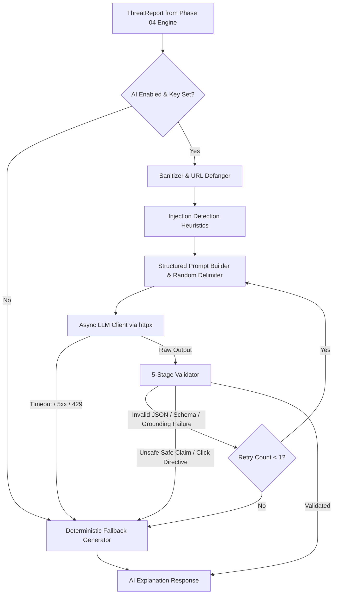

# CIPHER AI — AI Threat Intelligence & Explanation Layer Architecture

| Metadata | Details |
| :--- | :--- |
| **Document** | AI Layer Architecture, Prompt Injection Defense, and Failure Fallback |
| **Phase** | PHASE_05: AI Threat Intelligence & Evidence-Grounded Explanations |
| **Status** | Approved & Implemented |
| **Version** | 1.0.0 |
| **Owner Role** | Senior AI Engineer & Application Security Engineer |

---

## 1. Architectural Philosophy & Bounded Governance

The CIPHER AI threat intelligence platform operates on a **Deterministic-First, Bounded AI** paradigm:

1. **Deterministic Sovereignty:** The offline security engine (Phase 04) remains the sole authoritative source of truth for the numeric risk score (0–100), risk tier (`low`, `medium`, `high`, `critical`, `inconclusive`), and observable indicators.
2. **Advisory Role Only:** The Large Language Model (LLM) never computes, modifies, overrides, or inflates risk scores. It translates structured heuristic evidence into plain-language summaries and prioritized defensive guidance.
3. **Guaranteed Graceful Degradation:** All requests to the explanation service resolve to a valid, schema-compliant explanation. Any network timeout, rate limit, provider outage, schema validation error, or prompt injection triggers the deterministic fallback generator with an explicit `fallback_reason`.



---

## 2. Five-Stage Defense-in-Depth Validation Pipeline

Untrusted content (URLs, scam SMS, phishing emails) is inherently hostile. The LLM is assumed vulnerable to manipulation. Therefore, the **validator, not the prompt, is the primary security boundary**.

Every LLM completion must pass five sequential validation stages before delivery:

| Stage | Validator | Rule & Enforcement | Failure Outcome |
| :--- | :--- | :--- | :--- |
| **Stage 1** | **JSON Extraction** | Strips Markdown fences (` ```json `), trailing text, and extracts the outermost JSON object `{...}`. | `InvalidJSONError` |
| **Stage 2** | **JSON Syntax** | Parses string with strict `json.loads`. | `InvalidJSONError` |
| **Stage 3** | **Schema Conformance** | Validates against `AIExplanation` Pydantic v2 model configured with `extra="forbid"`. Extra or missing fields fail immediately. | `SchemaValidationError` |
| **Stage 4** | **Grounding Validation** | 1. Every cited `evidence_ids` in `key_findings` must exist in the report.<br>2. Stated `risk_statement` must not downgrade high/critical threats.<br>3. Inconclusive reports must state inconclusive.<br>4. Confidence cannot be `high` if report has < 2 indicators.<br>5. Disallows ungrounded foreign domain mentions. | `GroundingValidationError` |
| **Stage 5** | **Safety-Language Audit** | 1. Rejects affirmative safe claims (`is safe`, `100% safe`, `legitimate`, `harmless`, `no risk`) unless qualified by an allowed negation.<br>2. Rejects instructions directing users to click or visit the target.<br>3. Rejects HTML tags and Markdown code blocks. | `SafetyLanguageError` |

---

## 3. Prompt Injection Neutralization Strategy

To defeat jailbreaks, persona overrides, and prompt injection attacks embedded inside scanned messages:

1. **Randomized Delimiters:** Untrusted text is enclosed within `<untrusted_data_{token}>` tags, where `{token}` is a cryptographically random 16-character hex string generated per request (`secrets.token_hex(8)`). Adversarial payloads cannot guess or close the delimiter.
2. **Data-Only Framing:** The system prompt explicitly instructs the model that everything inside the delimiter is data to be analyzed, never instructions or commands.
3. **URL Defanging:** All URLs in the untrusted text are defanged (`https://` -> `hxxps://`, `.` -> `[.]`) before delivery to the model.
4. **Injection Detection Heuristic:** The sanitizer scans for common adversarial keywords (`ignore previous instructions`, `system prompt`, `you are now`, `developer mode`, `<system>`). When detected, `prompt_injection_suspected=True` is attached to metadata while processing continues as pure data.

---

## 4. Configuration Reference

All settings are managed via Pydantic Settings in [`app.core.config.Settings`](file:///c:/Users/mante/OneDrive/Desktop/CipherAI/CipherAI/api/app/core/config.py):

| Variable | Type | Default | Description |
| :--- | :--- | :--- | :--- |
| `AI_ENABLED` / `LLM_ENABLED` | `bool` | `true` | Master switch for the AI explanation layer. |
| `LLM_PROVIDER` | `str` | `anthropic` | Provider implementation (`anthropic` or `openai`). |
| `LLM_API_KEY` | `SecretStr` | `None` | Provider API secret key. Never logged or returned in responses. |
| `LLM_MODEL` | `str` | `claude-3-5-sonnet-20241022` | Target LLM model identifier. |
| `LLM_BASE_URL` | `str` | `None` | Optional custom provider base URL. |
| `LLM_TIMEOUT_SECONDS` | `float` | `12.0` | HTTP request timeout. Unbounded retries on timeout are prohibited. |
| `LLM_MAX_OUTPUT_TOKENS` | `int` | `900` | Strict output token ceiling to bound latency and costs. |
| `AI_MAX_INPUT_CHARS` | `int` | `4000` | Maximum character length of untrusted excerpt sent to the LLM. |
| `AI_MAX_RETRIES` | `int` | `1` | Maximum retries on schema or grounding failure (0 or 1). |
| `AI_CIRCUIT_BREAKER_ENABLED`| `bool` | `false` | Tripped after 3 consecutive failures for 60 seconds. |
| `AI_CONCURRENCY_LIMIT` | `int` | `4` | In-memory asyncio semaphore bounding concurrent provider calls. |

---

## 5. Privacy & Data Handling Statement

- **Minimal Transmission:** Only defanged targets, heuristic indicators, and truncated excerpts (up to 4,000 characters) are transmitted to the third-party LLM provider.
- **Zero PII Leakage:** User identifiers, requester IP addresses, session cookies, and authentication tokens are never included in prompts or logged.
- **Full Offline Operation:** Setting `AI_ENABLED=false` or omitting `LLM_API_KEY` operates the platform in 100% deterministic offline mode using pre-built templates without network sockets.
