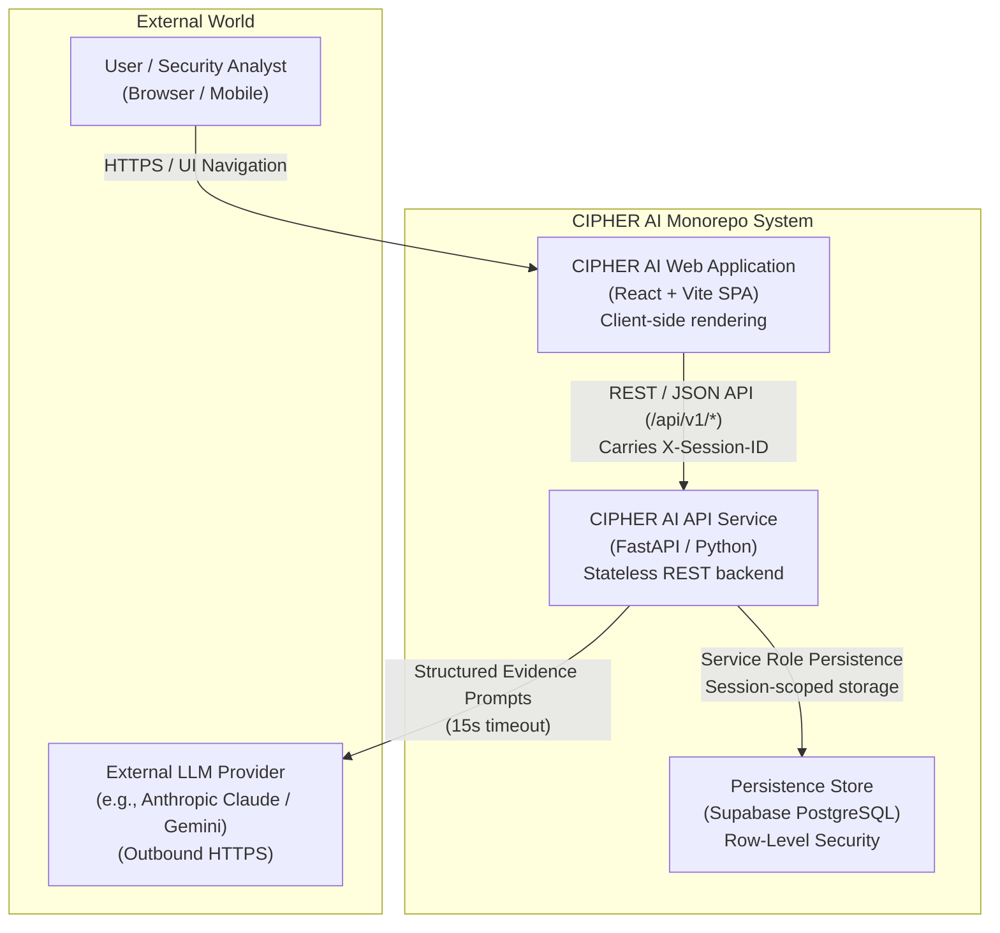
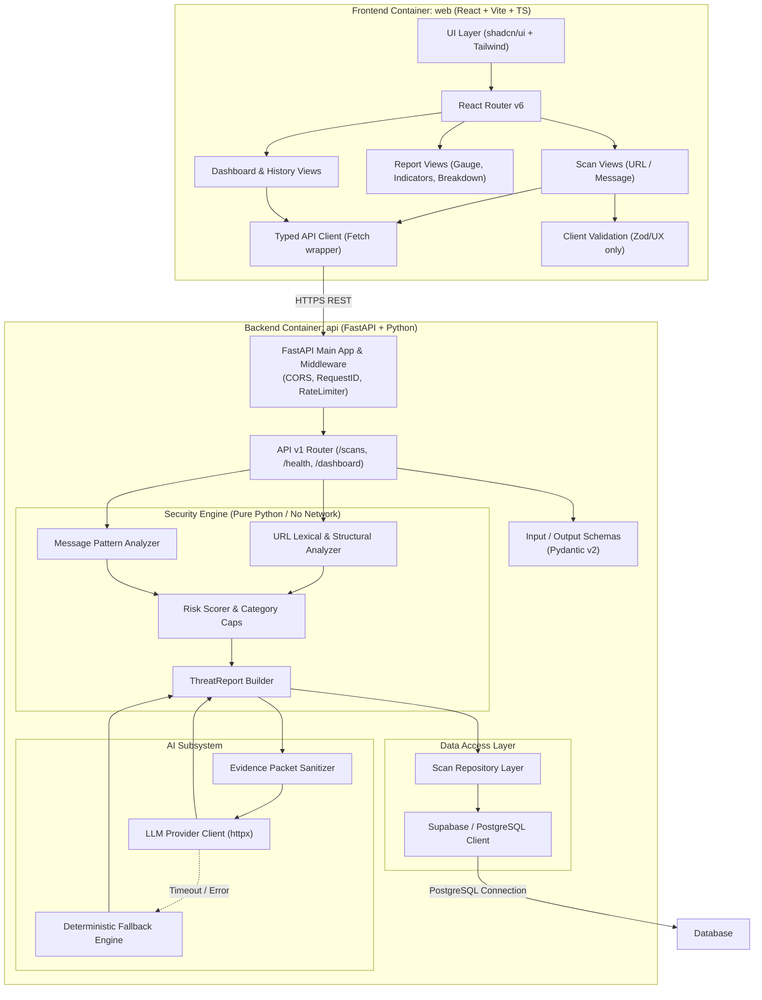
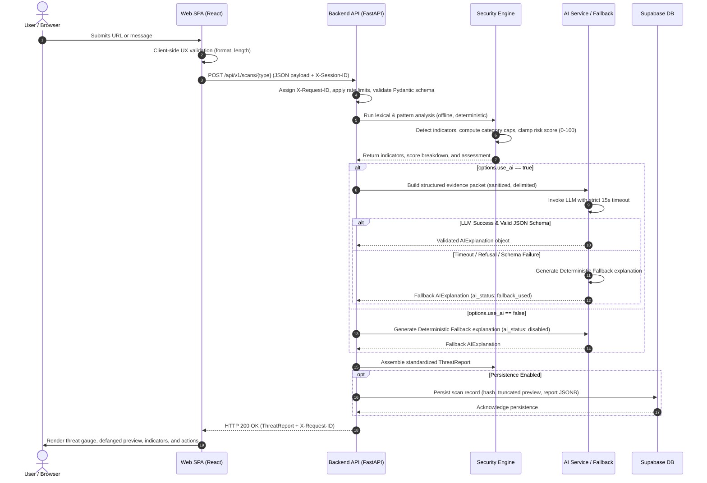
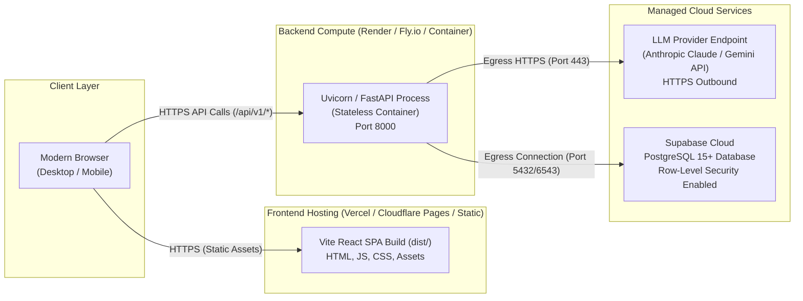

# CIPHER AI — System Architecture Specification

| Metadata | Details |
| :--- | :--- |
| **Title** | System Architecture Specification |
| **Phase** | PHASE_01: Requirements, Scope, Architecture, and Technical Specification |
| **Status** | Approved |
| **Version** | 1.0.0 |
| **Date** | 2026-10-22 |
| **Owner Role** | Senior Software Architect & Security Engineer |

---

## 1. System Overview

CIPHER AI is structured as a decoupled monorepo comprising a single-page React frontend application (`web`) and a stateless FastAPI backend service (`api`). The platform is designed around strict separation of concerns:
- **Deterministic Security Engine:** Executes lexical, syntactic, and structural threat analysis offline with zero outbound network calls.
- **AI Threat Intelligence Orchestrator:** Consumes sanitized structured evidence packets, invoking an LLM with strict output schema validation and immediate deterministic fallback.
- **Persistence Layer:** Supabase PostgreSQL with row-level security intent, supporting anonymous session isolation in MVP and seamless migration to Supabase Auth post-MVP.

---

## 2. Architecture Diagrams

### 2.1 System Context Diagram (C4 Level 1)



### 2.2 Container & Component Diagram (C4 Level 2)



### 2.3 Scan Data Flow Sequence Diagram



### 2.4 Deployment Architecture Diagram



---

## 3. Technology Rationale & Hackathon Constraints

| Component | Selected Technology | Alternative Considered | Rationale Under 12–24h Constraint |
| :--- | :--- | :--- | :--- |
| **Frontend Framework** | React 18 + Vite + TypeScript | Next.js / Nuxt | Vite offers instantaneous HMR, straightforward static deployment without SSR node runtime overhead, and seamless compatibility with pure client-side SPA routing. |
| **Styling & Components** | Tailwind CSS + shadcn/ui | MUI / Chakra UI | shadcn/ui provides pre-styled, accessible Radix-based primitives that live directly in the codebase, enabling rapid customization without heavyweight runtime CSS-in-JS dependencies. |
| **Data Visualization** | Recharts | D3.js / Chart.js | Recharts provides declarative, responsive React SVG charts that integrate natively with Tailwind theme tokens. |
| **Backend API** | Python 3.11+ / FastAPI | Node.js / Express / Go | FastAPI provides native async execution, automatic OpenAPI schema generation, and high-speed data validation via Pydantic v2. Python is also the standard language for security heuristics. |
| **Security Engine** | Pure Python Standard Library + `tldextract` | External microservice / Regex engines | Pure Python rules run completely offline in memory (< 5ms execution), ensuring zero network dependencies, zero cold starts, and zero SSRF risk. |
| **Persistence** | Supabase PostgreSQL | SQLite / MongoDB | Supabase provides immediate managed PostgreSQL with built-in Row-Level Security, ready for frictionless upgrade to user auth post-MVP. |

---

## 4. Module Responsibilities & Directory Mapping

```
cipher-ai/
├── README.md
├── .gitignore
├── docs/                             # Complete project documentation
├── web/                              # Frontend React SPA
│   ├── src/
│   │   ├── components/ui/            # Reusable shadcn/ui primitives
│   │   ├── components/layout/        # AppShell, TopBar, SidebarNav
│   │   ├── components/scan/          # ScanInputCard, DefangedDisplay
│   │   ├── components/report/        # RiskGauge, IndicatorList, ScoreBreakdownTable
│   │   ├── components/charts/        # Recharts visualizations
│   │   ├── lib/api/                  # Typed client for FastAPI endpoints
│   │   ├── lib/validation/           # Client-side UX validation schemas
│   │   └── types/                    # TypeScript interfaces mirroring ThreatReport
├── api/                              # Backend FastAPI Service
│   ├── app/
│   │   ├── core/                     # config.py, errors.py, logging.py, security.py
│   │   ├── api/v1/                   # FastAPI route handlers (health, scans, dashboard)
│   │   ├── schemas/                  # Pydantic v2 schemas for all data models
│   │   ├── engine/                   # Pure deterministic security analyzer modules
│   │   │   ├── url_validation.py     # RFC 3986 lexical validator
│   │   │   ├── url_analyzer.py       # Indicator detection rules for URLs
│   │   │   ├── message_analyzer.py   # Indicator detection rules for messages
│   │   │   ├── scoring.py            # Category caps and clamped score calculator
│   │   │   └── report_builder.py     # Assembles standardized ThreatReport
│   │   ├── ai/                       # LLM orchestration & fallback
│   │   │   ├── client.py             # HTTP client with timeout & retry budget
│   │   │   ├── prompts.py            # System prompts with delimited evidence injection
│   │   │   ├── schemas.py            # Pydantic schema for structured output
│   │   │   └── fallback.py           # Deterministic template fallback generator
│   │   └── repositories/             # Persistence abstraction (Supabase / In-Memory)
└── supabase/                         # Database schema and migrations
```

---

## 5. Planned SSRF-Safe Fetcher Specification

### 5.1 MVP Policy: Zero Fetching
In the MVP, CIPHER AI **does not fetch, resolve, or make any network requests to user-supplied URLs**. All analysis is strictly lexical, syntactic, and structural. This design eliminates Server-Side Request Forgery (SSRF) at the architectural level.

### 5.2 Future Fetcher Specifications (Post-MVP Requirement)
If a future phase (e.g., Phase 08) introduces dynamic website content inspection, it **must** strictly enforce the following multi-layer defense-in-depth controls:

1. **Protocol Scheme Allowlist:** Strictly permit `http://` and `https://` only. Block `file://`, `gopher://`, `ftp://`, `dict://`, `data:`, `javascript:`, and all other schemes.
2. **Pre-Flight DNS Resolution & IP Filtering:**
   - Resolve DNS records prior to opening socket connections.
   - Inspect every resolved IP address against non-routable CIDR blocks:
     - Private IPv4 (RFC 1918): `10.0.0.0/8`, `172.16.0.0/12`, `192.168.0.0/16`
     - Loopback (RFC 1122): `127.0.0.0/8`
     - Link-Local (RFC 3927): `169.254.0.0/16` (including cloud metadata services like `169.254.169.254`)
     - Broadcast & Multicast: `224.0.0.0/4`, `240.0.0.0/4`, `255.255.255.255/32`
     - IPv6 equivalents: `::1`, `fc00::/7`, `fe80::/10`
3. **DNS Rebinding Prevention:** Pin the validated IP address and connect directly to that IP via custom socket transport, passing the original hostname exclusively in the HTTP `Host` header and TLS SNI.
4. **Manual Redirect Traversal:** Disable automated HTTP client redirect following. Inspect each HTTP 3xx redirect target individually, repeating the full DNS and IP validation routine at every hop (maximum 3 hops).
5. **Resource and Timeout Ceilings:**
   - Connection timeout: 3 seconds.
   - Read timeout: 5 seconds.
   - Maximum response body size: 512 KB (enforced via streaming chunk termination).
   - Content-Type restriction: inspect only `text/html`, `application/xhtml+xml`.
6. **Network Isolation:** Run the fetcher process inside an isolated network sandbox or VPC with egress firewalls blocking all traffic to internal cluster subnets and cloud metadata endpoints.

---

## 6. Locked Architecture Decisions

1. **Deterministic Primary Source of Truth:** The deterministic rules engine owns the risk score. The LLM explains and summarizes findings but cannot raise or lower the score without a recorded, bounded contribution.
2. **Strict Offline Execution for MVP:** The backend performs no outbound network fetching of submitted links.
3. **No Certification of Safety:** No report or UI view may ever present the verdict "safe" or guarantee non-maliciousness. The most favorable verdict is `low` with the label *"Low risk indicators found."*
4. **Standardized Error Enveloping:** All API endpoints must format non-2xx responses using the standard error envelope `{ error: { code, message, details, request_id } }`.
5. **Backend Secret Isolation:** Secret keys (`LLM_API_KEY`, `SUPABASE_SERVICE_ROLE_KEY`) are backend-only and forbidden in frontend code.
6. **Defanged Presentation:** URLs flagged with indicators are rendered defanged and unclickable by default.

---

## 7. Document Cross-References

- [Product Requirements Document](file:///c:/Users/HP/OneDrive/Desktop/CipherAI/docs/requirements/PRD.md)
- [Risk Scoring Specification](file:///c:/Users/HP/OneDrive/Desktop/CipherAI/docs/architecture/risk-scoring-spec.md)
- [AI Safety Specification](file:///c:/Users/HP/OneDrive/Desktop/CipherAI/docs/architecture/ai-spec.md)
- [Data Model Specification](file:///c:/Users/HP/OneDrive/Desktop/CipherAI/docs/architecture/data-model.md)
- [Threat and Abuse Model](file:///c:/Users/HP/OneDrive/Desktop/CipherAI/docs/security/threat-model.md)
