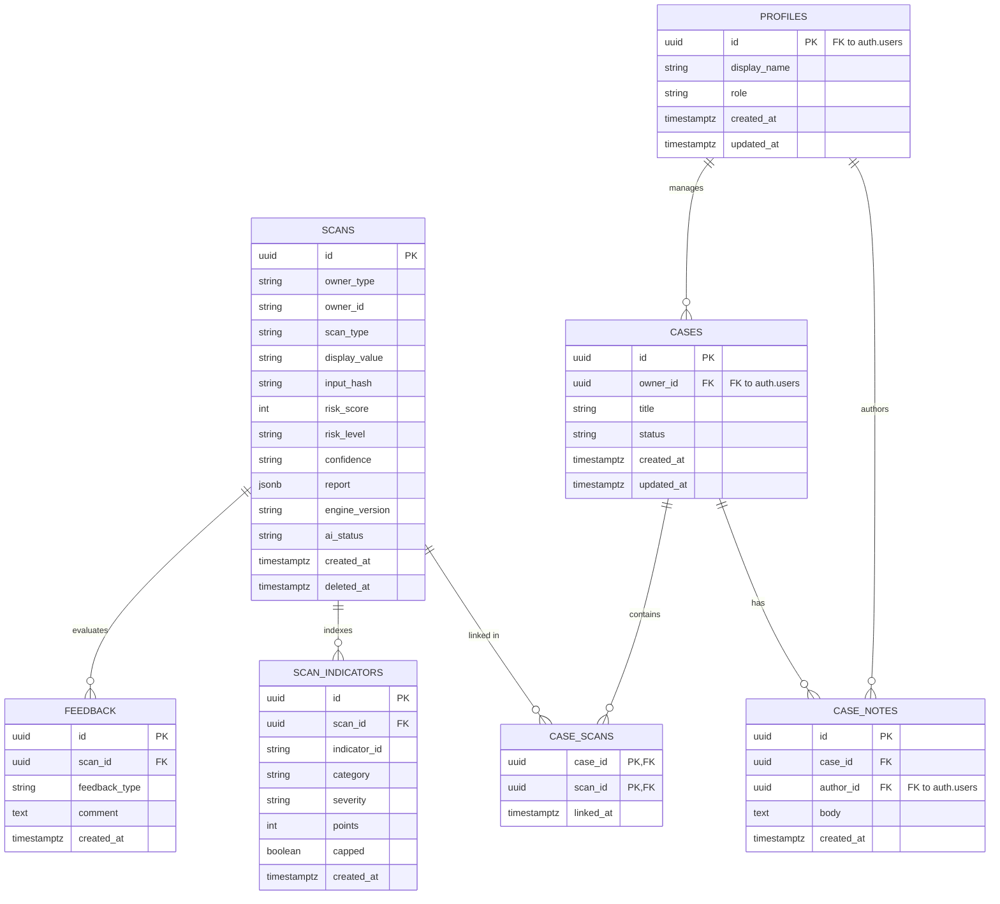

# CIPHER AI — Data Model and Persistence Specification

| Metadata | Details |
| :--- | :--- |
| **Title** | Data Model and Persistence Specification |
| **Phase** | PHASE_01: Requirements, Scope, Architecture, and Technical Specification |
| **Status** | Approved |
| **Version** | 1.0.0 |
| **Date** | 2026-10-22 |
| **Owner Role** | Senior Software Architect & Database Engineer |

---

## 1. Overview & Privacy Philosophy

CIPHER AI uses **Supabase PostgreSQL** for threat intelligence persistence, session-scoped history, and dashboard aggregations. 

### 1.1 Privacy and Data Protection Invariants
1. **Zero Raw Message Retention:** When a user scans a scam message, the system **never stores the raw message text** in database tables or logs. Users frequently paste messages containing sensitive personal details, OTPs, or financial information. Storing raw message text creates an unacceptable data exposure risk.
2. **Safe Representations:** The database stores:
   - `input_hash`: Cryptographic SHA-256 hash of the normalized input (for deduplication and analytics).
   - `display_value`: A sanitized, defanged, and truncated preview (maximum 200 characters for messages; defanged for URLs).
   - `report`: The full structured `ThreatReport` stored as `jsonb`.
3. **Multi-Tenancy & Isolation:** In the MVP, scans are tagged with `owner_type: 'anonymous_session'` and an unguessable client-scoped `owner_id`. Post-MVP transitions authenticated users to `owner_type: 'user'` linked to Supabase Auth (`auth.users.id`).

---

## 2. Entity Relationship Diagram (ERD)



---

## 3. Database Schema Definitions

### 3.1 `scans` Table (MVP Core)

Stores threat intelligence scan results and full JSON reports.

| Column | Type | Constraints | Description |
| :--- | :--- | :--- | :--- |
| `id` | `uuid` | `PRIMARY KEY DEFAULT gen_random_uuid()` | Unique immutable scan report identifier. |
| `owner_type` | `text` | `NOT NULL CHECK (owner_type IN ('anonymous_session', 'user'))` | Distinguishes session tokens from registered users. |
| `owner_id` | `text` | `NOT NULL` | Session UUID (MVP) or Supabase `auth.uid()` string (post-MVP). |
| `scan_type` | `text` | `NOT NULL CHECK (scan_type IN ('url', 'message', 'email', 'batch_item'))` | Asset category analyzed. |
| `display_value` | `text` | `NOT NULL` | Defanged URL or truncated sanitized preview (max 200 chars). |
| `input_hash` | `text` | `NOT NULL` | SHA-256 hash of normalized input. |
| `risk_score` | `integer` | `NOT NULL CHECK (risk_score >= 0 AND risk_score <= 100)` | Final clamped threat rating. |
| `risk_level` | `text` | `NOT NULL CHECK (risk_level IN ('low', 'medium', 'high', 'critical', 'inconclusive'))` | Derived threat tier. |
| `confidence` | `text` | `NOT NULL CHECK (confidence IN ('low', 'medium', 'high'))` | Evidence certainty rating. |
| `report` | `jsonb` | `NOT NULL` | Complete canonical `ThreatReport` JSON. |
| `engine_version` | `text` | `NOT NULL` | Semantic version of the analyzer rules engine (e.g. `1.0.0`). |
| `ai_status` | `text` | `NOT NULL CHECK (ai_status IN ('used', 'fallback_used', 'disabled'))` | Status of AI explanation generation. |
| `created_at` | `timestamptz` | `NOT NULL DEFAULT now()` | Scan generation timestamp in UTC. |
| `deleted_at` | `timestamptz` | `NULL` | Soft deletion timestamp for user history removals. |

#### Indexes
- `idx_scans_owner_created`: `(owner_type, owner_id, created_at DESC)` — Optimizes history list queries.
- `idx_scans_input_hash`: `(input_hash)` — Fast deduplication lookup.
- `idx_scans_risk_level`: `(risk_level)` — Dashboard risk-tier distribution queries.
- `idx_scans_active`: `(deleted_at) WHERE deleted_at IS NULL` — Partial index filtering active scans.

---

### 3.2 `scan_indicators` Table (MVP Analytics / Normalization)

Normalizes individual triggered indicators for high-performance aggregation on the dashboard (e.g., top 5 most common threat indicators across all scans).

| Column | Type | Constraints | Description |
| :--- | :--- | :--- | :--- |
| `id` | `uuid` | `PRIMARY KEY DEFAULT gen_random_uuid()` | Primary key. |
| `scan_id` | `uuid` | `NOT NULL REFERENCES scans(id) ON DELETE CASCADE` | Associated scan record. |
| `indicator_id` | `text` | `NOT NULL` | Stable code (e.g., `URL_IP_HOST`, `MSG_URGENCY_DEADLINE`). |
| `category` | `text` | `NOT NULL` | Category grouping. |
| `severity` | `text` | `NOT NULL CHECK (severity IN ('info', 'low', 'medium', 'high', 'critical'))` | Indicator severity. |
| `points` | `integer` | `NOT NULL` | Default points allocated. |
| `capped` | `boolean` | `NOT NULL DEFAULT false` | Whether category cap reduced this finding. |
| `created_at` | `timestamptz` | `NOT NULL DEFAULT now()` | Creation timestamp. |

#### Indexes
- `idx_scan_indicators_id_count`: `(indicator_id, created_at DESC)` — Dashboard top-indicator aggregations.

---

### 3.3 Post-MVP Tables (Draft Specification)

- **`profiles`:** Extends Supabase `auth.users(id)` with user display names, enterprise roles (`analyst`, `admin`), and team ownership.
- **`cases`:** Investigative dossiers grouping related scans (`status IN ('open', 'investigating', 'resolved', 'archived')`).
- **`case_scans`:** Composite many-to-many join table between `cases` and `scans`.
- **`case_notes`:** Immutable timestamped investigator notes (`max 5000 characters`) tied to a case.
- **`watchlists`:** Monitored domains and brand keywords scheduled for recurring re-scans.
- **`feedback`:** End-user true/false positive reports and comments for AI evaluation.

---

## 4. Row-Level Security (RLS) Strategy & Ownership Intent

Row-Level Security is **enabled on every table** in PostgreSQL.

```sql
ALTER TABLE scans ENABLE ROW LEVEL SECURITY;
ALTER TABLE scan_indicators ENABLE ROW LEVEL SECURITY;
```

### 4.1 MVP Security Model (Anonymous Sessions)
- **Direct Client Access Disabled:** The public `anon` role has **zero** default permissions (`SELECT`, `INSERT`, `UPDATE`, `DELETE`) on the `scans` table.
- **Backend Service-Role Access:** The FastAPI backend connects using the elevated `service_role` key.
- **Repository-Level Enforcement:** The FastAPI data access layer parses the client's `X-Session-ID` header and injects `WHERE owner_id = :session_id AND owner_type = 'anonymous_session' AND deleted_at IS NULL` into all history and delete operations.

### 4.2 Post-MVP Security Model (Supabase Auth Migration)
When Supabase Auth is activated, authenticated requests pass the user's Supabase JWT. RLS policies enforce multi-tenant isolation at the database engine level:

```sql
-- Select policy for authenticated users
CREATE POLICY user_scans_select ON scans
    FOR SELECT
    USING (
        (owner_type = 'user' AND owner_id = auth.uid()::text) OR
        (owner_type = 'anonymous_session' AND owner_id = current_setting('request.headers', true)::json->>'x-session-id')
    );

-- Delete policy (soft delete)
CREATE POLICY user_scans_delete ON scans
    FOR UPDATE
    USING (owner_type = 'user' AND owner_id = auth.uid()::text)
    WITH CHECK (owner_type = 'user' AND owner_id = auth.uid()::text);
```

---

## 5. Data Retention & Deletion Policy

- **Anonymous Session TTL:** Anonymous scan records older than **30 days** are purged via an automated cron trigger or background maintenance worker (`DELETE FROM scans WHERE owner_type = 'anonymous_session' AND created_at < now() - INTERVAL '30 days'`).
- **User-Initiated Deletion:** When a user clicks "Delete" on `/history`, the record is marked with `deleted_at = now()` (soft delete), immediately hiding it from all queries. A daily purge removes soft-deleted records.

---

## 6. Document Cross-References

- [Draft Schema SQL](file:///c:/Users/HP/OneDrive/Desktop/CipherAI/docs/architecture/schema-draft.sql)
- [System Architecture](file:///c:/Users/HP/OneDrive/Desktop/CipherAI/docs/architecture/architecture.md)
- [Threat and Abuse Model](file:///c:/Users/HP/OneDrive/Desktop/CipherAI/docs/security/threat-model.md)
- [API Contracts](file:///c:/Users/HP/OneDrive/Desktop/CipherAI/docs/api/api-contracts.md)
