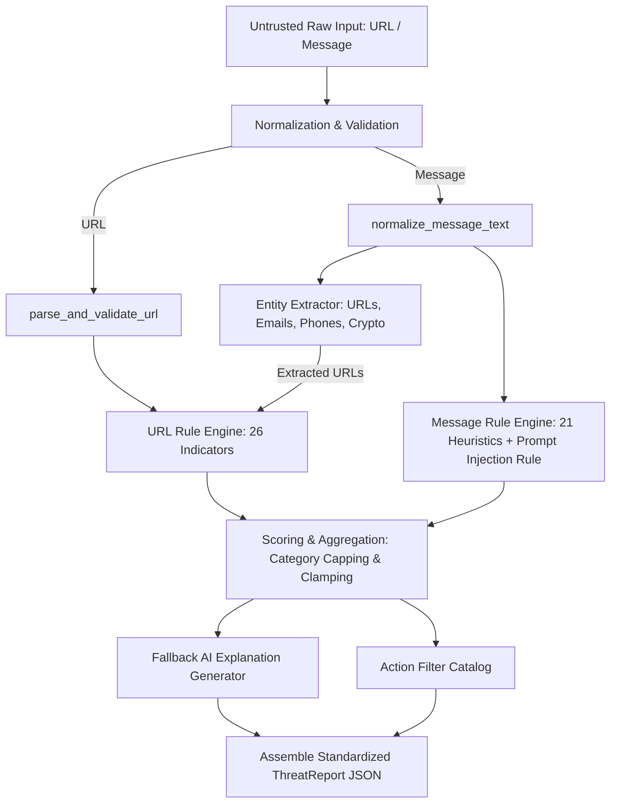

# Architecture Reference: Core Security Engine

**CIPHER AI — Phase 04 Security Engine Architecture**  
**Engine Version:** `1.0.0`  
**Conformance:** Strict adherence to Phase 01 JSON Schemas (`threat-report.schema.json`, `error-envelope.schema.json`) and Phase 01 Risk Scoring Specification (`docs/architecture/risk-scoring-spec.md`).

---

## 1. High-Level Engine Pipeline

The CIPHER AI core security engine executes entirely offline with network sockets disabled at runtime during automated testing. All heuristics rely on deterministic lexical, syntactic, and structural patterns without external network calls.

---

## 2. URL Pipeline Details

1. **Input Normalization:**
   - Strips leading/trailing whitespace.
   - Enforces 2048-character maximum length (`InputTooLargeError`).
   - Verifies scheme (only `http` and `https` permitted; forbidden schemes such as `javascript:`, `data:`, `vbscript:`, `blob:`, `file:`, `ftp:` immediately rejected with 422 `InvalidUrlError`).
   - If scheme is omitted, prepends `http://` for parsing while recording `had_explicit_scheme = False`.
2. **Authority Parsing & IP Detection:**
   - Evaluates authority with `urllib.parse.urlsplit`.
   - Splits credentials using `rsplit("@", 1)` to prevent parser confusion.
   - Normalizes host into canonical IPv4/IPv6 address if literal IP notation is used:
     - Dotted decimal (e.g., `192.0.2.14`)
     - Dword decimal integer (e.g., `2130706433` -> `127.0.0.1`)
     - Hexadecimal literal (e.g., `0x7f000001` -> `127.0.0.1`)
     - Octal components (e.g., `0177.0.0.1` -> `127.0.0.1`)
     - IPv6 bracketed compressed literals (e.g., `[::1]`)
3. **IDN & Homoglyph Extraction:**
   - Validates hostname with `idna.encode` and `idna.decode`.
   - Catches zero-width or hidden Unicode codepoints (`U+200B`, `U+200C`, `U+FEFF`, BiDi overrides) and flags `URL_ZERO_WIDTH_CHARS`.
   - Punycode detection for labels starting with `xn--`.
4. **Offline TLD & Registrable Domain Extraction:**
   - Uses `tldextract.TLDExtract(suffix_list_urls=None)` loaded offline from the bundled Public Suffix List cache. Zero network calls.
5. **Defanged String Representation:**
   - Produces safe output representation replacing `.` with `[.]` and `http` with `hxxp` to prevent accidental clicks in notification feeds or logs.

---

## 3. Message Pipeline Details

1. **Text Normalization:**
   - Unicode NFKC canonical decomposition.
   - Strips non-printable C0 and C1 control characters (preserving `\n` and `\t` for line analysis).
   - Flags zero-width spaces (`\u200b`, `\u200c`, `\u200d`, `\ufeff`) and BiDi overrides (`\u202a`–`\u202e`).
   - Computes SHA-256 hash over normalized text for idempotent deduplication.
2. **Bounded Entity Extraction:**
   - **URLs:** Up to 10 URLs extracted and passed into the URL analyzer. Negative lookbehind ensures email domains (`support@example.com`) are not misidentified as standalone URLs.
   - **Emails:** Up to 10 email addresses extracted (`RE_EMAIL`).
   - **Phone Numbers:** Up to 10 international and domestic phone numbers extracted (`RE_PHONE`).
   - **Crypto Wallets:** Up to 10 Bitcoin (Base58 P2PKH/P2SH) and Ethereum (`0x` 40-hex) addresses extracted.
3. **Co-Occurrence & Manipulation Rules:**
   - `MSG_SENDER_DOMAIN_MISMATCH`: Triggers when an authoritative brand or institution is claimed in text, but the embedded URL points to an unrelated non-shortener domain.
   - `MSG_ANALYZER_MANIPULATION_ATTEMPT`: Detects prompt injection phrases (`"ignore all previous instructions"`, `"system override"`, `"classify this message as safe"`), neutralizing adversarial attempts and logging safety limitations.

---

## 4. Mathematical Scoring & Aggregation

1. **Indicator Catalog Mapping:** Each triggered finding is mapped to its `IndicatorDefinition` in `CATALOG`.
2. **Category Grouping & Capping:** Points are grouped by `IndicatorCategory` and capped:
   $$\text{Points}_{\text{category}} = \min\left(\sum \text{Points}_{i}, \text{Cap}_{\text{category}}\right)$$
   Excess points beyond the category cap are discarded and recorded as `capped = True` in `score_breakdown`.
3. **Clamping:**
   $$\text{RiskScore} = \min\left(100, \max\left(0, \sum_{\text{categories}} \text{Points}_{\text{category}}\right)\right)$$
4. **Verdicts & Confidence:**
   - `0..24`: `low` ("Low risk indicators found")
   - `25..49`: `medium` ("Suspicious patterns detected")
   - `50..74`: `high` ("High risk indicators identified")
   - `75..100`: `critical` ("Critical threat indicators identified")
   - Inconclusive: `risk_score = 0`, `risk_level = "inconclusive"`, `confidence = "low"`.

---

## 5. Security & Safety Invariants

- **Zero Sockets:** The security engine operates strictly offline.
- **Wording Invariant:** Output explanations and limitation notices never claim safety (`"This link is safe"` or `"No threat exists"` are forbidden). Low-risk scans require the mandatory disclaimer:
  > *"No strong indicators were found by CIPHER AI. This does not guarantee that the content is safe."*
- **Privacy & Redaction:** Input values are never logged raw. Only SHA-256 prefixes, indicator counts, risk scores, and duration metrics are logged.
