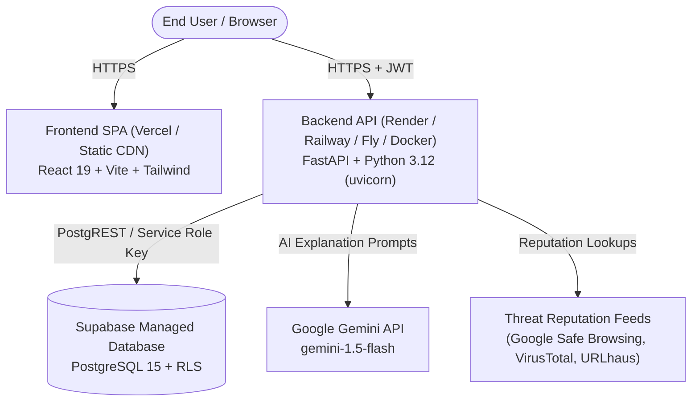

# CIPHER AI: Production Deployment & Operations Guide

This guide details the step-by-step procedure for deploying and operating CIPHER AI in production across modern, zero-maintenance cloud infrastructure.

---

## 1. System Architecture



---

## 2. Deployment Prerequisites

Before beginning the production deployment:
1. **GitHub Repository**: Ensure the latest code is committed to `main` at `https://github.com/tanveersidhux/CipherAI`.
2. **Supabase Project**: An active project created at [supabase.com](https://supabase.com).
3. **Backend Host**: An account on [Render.com](https://render.com), [Railway.app](https://railway.app), or any Docker-compatible PaaS.
4. **Frontend Host**: An account on [Vercel.com](https://vercel.com) or [Cloudflare Pages](https://pages.cloudflare.com).
5. **Google Gemini API Key**: An active key from [Google AI Studio](https://aistudio.google.com).

---

## 3. Step 1: Database Setup (Supabase)

1. Open your Supabase project dashboard -> **SQL Editor**.
2. Run the migration scripts located in `supabase/migrations/` sequentially:
   - `20261023000001_phase07_core_tables.sql` (Creates `scans`, `scan_evidence`, `scan_explanations`)
   - `20261023000002_phase07_cases.sql` (Creates `cases`, `case_scans`, `case_notes`, `case_events`)
   - `20261023000003_phase07_tags_optional.sql` (Creates `tags`, `scan_tags`)
   - `20261023000004_phase07_rls_policies.sql` (Applies strict Row-Level Security policies to all tables)
   - `20261023000005_phase07_analytics_and_functions.sql` (Creates functions and automated triggers)
   - `20261023000006_phase08_scan_type_email_and_reputation.sql` (Adds email scan support & reputation columns)
   - `20261023000007_phase08_batches.sql` (Creates `batch_jobs` and `batch_items`)
3. Verify RLS is enabled on all tables by running:
   ```bash
   python scripts/audit_rls.py
   ```
4. Note down the following credentials from **Project Settings** -> **API**:
   - `Project URL` (`SUPABASE_URL`)
   - `anon public` key (`SUPABASE_ANON_KEY`)
   - `service_role` secret key (`SUPABASE_SERVICE_ROLE_KEY`)
   - `JWT Secret` from **Project Settings** -> **API** -> **JWT Settings** (`SUPABASE_JWT_SECRET`)

---

## 4. Step 2: Backend API Deployment

### Option A: Render.com (Recommended)
1. In Render Dashboard, click **New** -> **Blueprint** and select your GitHub repository (`tanveersidhux/CipherAI`).
2. Render detects `render.yaml` automatically.
3. Configure the following environment variables in the Render web dashboard under **Environment**:

| Environment Variable | Recommended Production Value | Description |
| :--- | :--- | :--- |
| `APP_ENV` | `production` | Enforces production constraints (HTTPS CORS, disabled docs) |
| `LOG_LEVEL` | `INFO` | Structured JSON log output |
| `CORS_ALLOWED_ORIGINS` | `https://<your-vercel-app>.vercel.app` | Comma-separated list of allowed frontend HTTPS origins |
| `SUPABASE_URL` | `https://<project-ref>.supabase.co` | Supabase Project URL |
| `SUPABASE_ANON_KEY` | `eyJ...` | Supabase publishable anonymous key |
| `SUPABASE_SERVICE_ROLE_KEY` | `eyJ...` | Supabase server-side service role secret key |
| `SUPABASE_JWT_SECRET` | `<jwt-secret>` | Supabase auth JWT signing secret |
| `GEMINI_API_KEY` | `<your-gemini-key>` | Google AI Studio API key |
| `AI_ENABLED` | `true` | Enables AI explanation generation |
| `LLM_PROVIDER` | `gemini` | Uses Google Gemini REST client |
| `LLM_MODEL` | `gemini-1.5-flash` | Ultra-fast, cost-effective multimodal model |

4. Health Check Path: `/health`
5. Click **Deploy**.
6. Once deployed, note your backend URL (e.g., `https://cipher-ai-api.onrender.com`).
7. Verify by testing:
   ```bash
   curl -i https://cipher-ai-api.onrender.com/health
   ```
   Expected response: `200 OK` with JSON payload `{"status":"ok","dependencies":{"database":"ok","llm":"enabled"}}`.

### Option B: Docker Container Deployment
Use the included `api/Dockerfile`:
```bash
docker build -t cipher-ai-api ./api
docker run -d -p 8000:8000 \
  -e APP_ENV=production \
  -e CORS_ALLOWED_ORIGINS=https://cipher.yourdomain.com \
  -e SUPABASE_URL=https://<project-ref>.supabase.co \
  -e SUPABASE_SERVICE_ROLE_KEY=<service-role-key> \
  -e GEMINI_API_KEY=<gemini-api-key> \
  cipher-ai-api
```

---

## 5. Step 3: Frontend Deployment (Vercel)

1. Log into [Vercel](https://vercel.com) and click **Add New Project**.
2. Import the `CipherAI` repository.
3. Configure the project settings:
   - **Framework Preset**: `Vite`
   - **Root Directory**: `web`
   - **Build Command**: `npm run build`
   - **Output Directory**: `dist`
4. In **Environment Variables**, add:

| Environment Variable | Production Value | Description |
| :--- | :--- | :--- |
| `VITE_API_BASE_URL` | `https://cipher-ai-api.onrender.com` | Deployed backend URL (no trailing slash) |
| `VITE_SUPABASE_URL` | `https://<project-ref>.supabase.co` | Supabase Project URL for authentication |
| `VITE_SUPABASE_ANON_KEY` | `<anon-publishable-key>` | Supabase anonymous public key |

5. Deploy. The included `web/vercel.json` automatically configures SPA client-side routing rewrites and security response headers.
6. Note the deployed URL (e.g., `https://cipher-ai-web.vercel.app`).
7. **Important**: Go back to your backend hosting (e.g. Render) and ensure `CORS_ALLOWED_ORIGINS` includes `https://cipher-ai-web.vercel.app`!

---

## 6. Step 4: Verification & Smoke Testing Checklist

Run through these smoke tests against the deployed environment:

- [ ] **Health Endpoint**:
  ```bash
  curl https://<backend-domain>/health
  ```
  Status must be `"ok"`, with database reported as `"ok"`.
- [ ] **Frontend Loading**: Visit `https://<frontend-domain>/` in browser; verify landing page renders with zero console errors.
- [ ] **Client Routing Fallback**: Refresh page at `https://<frontend-domain>/scans/url` and `https://<frontend-domain>/cases`; verify page reloads correctly (no 404).
- [ ] **URL Threat Scan**: Submit a known phishing URL (e.g., `http://paypa1-security-check.com.ru/login.php`); verify threat report is generated with critical/high risk level, indicators, and defanged display.
- [ ] **Scam Message Scan**: Submit a suspicious SMS text; verify indicators are extracted.
- [ ] **AI Explanation**: On the report view, check the AI explanation panel. If Gemini is configured, it renders executive summary, risk statement, and guidance. If not configured or quota exceeded, rule-based fallback is seamlessly presented.
- [ ] **Authentication & Case Management**: Log in with test account; verify scan results can be saved to a case, and listed under `/cases`.
- [ ] **Exporting**: Download JSON and CSV reports from the report menu; verify formatting and neutralized CSV cells.

---

## 7. Security Best Practices

1. **Zero Secret Leakage**:
   - Never commit `.env` files.
   - Run `node scripts/check-no-secrets-in-web.mjs` before each release.
   - Backend `GEMINI_API_KEY` and `SUPABASE_SERVICE_ROLE_KEY` must only exist in server hosting environment variables.
2. **CORS Hardening**:
   - Wildcards (`*`) are rejected by the backend in `production` mode.
   - All CORS origins must specify `https://`.
3. **Database Security**:
   - Supabase Row-Level Security (RLS) is enabled on all tables.
   - Anonymous clients can only access public scan schemas and authenticated users can only view their own cases, notes, and scans.
4. **SSRF Defenses**:
   - The scanning engine rejects loopback (`127.0.0.1`), private RFC 1918 IPs, link-local, cloud metadata IP (`169.254.169.254`), and IPv6 equivalents.
