# CIPHER AI — Information Architecture and Navigation Specification

| Metadata | Details |
| :--- | :--- |
| **Title** | Information Architecture and Navigation Specification |
| **Phase** | PHASE_02: UI/UX Design System, Page Layouts, Navigation, Reusable Components, Responsive Design, and User Flows |
| **Status** | Approved |
| **Version** | 1.0.0 |
| **Date** | 2026-10-22 |
| **Owner Role** | Senior UI/UX Designer & Frontend Architect |

---

## 1. Information Architecture Overview

CIPHER AI organizes threat intelligence workflows into two primary cognitive loops:
1. **The Tactical Scan Loop (Primary User Flow):** Fast submission of a suspicious URL or scam message, immediate analysis, and presentation of the structured threat report with clear defensive guidance.
2. **The Investigation & Audit Loop (Operational Flow):** Reviewing historical scans, analyzing aggregate risk patterns across time on the dashboard, and configuring investigative preferences.

The application uses client-side routing powered by `react-router-dom` with code-split lazy loading (`React.lazy` and `Suspense`) to ensure minimal initial bundle transfer.

---

## 2. Sitemap and Route Hierarchy

```mermaid
graph TD
    Root["/ (AppShell / Layout)"] --> Home["/ (Landing & Quick Scan)"]
    Root --> ScanURL["/scan/url (Dedicated URL Scanner)"]
    Root --> ScanMsg["/scan/message (Dedicated Message Scanner)"]
    Root --> Report["/reports/:reportId (Threat Report View)"]
    Root --> History["/history (Scan History & Search)"]
    Root --> Dashboard["/dashboard (Analytics & Metrics)"]
    Root --> Settings["/settings (Preferences & Security Notes)"]
    Root --> CasesPlaceholder["/cases (Post-MVP Dossier Placeholder)"]
    Root --> DevStates["/dev/states (Dev-only State Switcher)"]
    Root --> NotFound["* (404 Not Found Catch-All)"]

    classDef primary fill:#0F172A,stroke:#06B6D4,stroke-width:2px,color:#F8FAFC;
    classDef secondary fill:#1E293B,stroke:#94A3B8,stroke-width:1px,color:#E2E8F0;
    classDef dev fill:#312E81,stroke:#818CF8,stroke-width:1px,color:#EEF2FF;
    
    class Home,ScanURL,ScanMsg,Report,History,Dashboard primary;
    class Settings,CasesPlaceholder,NotFound secondary;
    class DevStates dev;
```

---

## 3. Route Inventory and Access Rules

| Route Path | Page Title | Navigation Category | Purpose & Description | Access & Feature Flag |
| :--- | :--- | :--- | :--- | :--- |
| `/` | Landing & Quick Scan | Primary | High-impact hero introduction, instant dual-mode scan form (URL/Message), core value cards, recent scans snippet. | Public MVP |
| `/scan/url` | Scan URL | Primary | Dedicated URL scanner with advanced options toggle (AI toggle, session persist toggle), input validation, helper text. | Public MVP |
| `/scan/message` | Scan Message | Primary | Dedicated SMS/email/chat scanner with live character counter (5000 max), channel select dropdown, helper text. | Public MVP |
| `/reports/:reportId` | Threat Report | Contextual | Full canonical threat report view with risk gauge, AI summary, indicators, score breakdown table, timeline, actions. | Deep-link / Post-scan |
| `/history` | Scan History | Primary | Searchable, filterable list of scans in current session; sortable table with mobile card transformation and delete action. | Public MVP |
| `/dashboard` | Threat Dashboard | Primary | High-level analytics: total scans, risk distribution chart, 14-day trend line, top indicators list, recent activity. | Public MVP |
| `/settings` | Settings | Secondary | Theme mode switcher (light/dark/system), anonymous session ID display, offline capability info, storage reset. | Public MVP |
| `/cases` | Case Dossiers | Secondary (Hidden) | Post-MVP placeholder view displaying "Coming in Phase 08" empty state. | Hidden unless `ENABLE_CASES=true` |
| `/dev/states` | Component State Switcher | Internal | Development-only state testing harness for empty, loading, error, and edge-case reports. | Stripped from production build |
| `*` | Page Not Found | Catch-all | Accessible 404 page with return-home action and report navigation. | Public |

---

## 4. Navigation Architecture

### 4.1 Desktop Navigation (≥ 1024px)
- **Left Persistent Sidebar (`SidebarNav`):** Width: `240px`, fixed position with full viewport height.
  - **Header:** Inline SVG CIPHER AI Wordmark and glyph (`Logo`).
  - **Primary Section:** Vertical list of navigation items:
    - *Home* (`/`, icon: `Home`)
    - *Scan URL* (`/scan/url`, icon: `Link`)
    - *Scan Message* (`/scan/message`, icon: `MessageSquareWarning`)
    - *History* (`/history`, icon: `History`)
    - *Dashboard* (`/dashboard`, icon: `BarChart3`)
  - **Secondary Section (Bottom Pin):**
    - *Cases* (`/cases`, icon: `FolderLock`, conditionally rendered based on `ENABLE_CASES` constant)
    - *Settings* (`/settings`, icon: `Settings`)
    - *Theme Toggle* (`ThemeToggle` with dropdown or segmented control)

### 4.2 Tablet Navigation (768px – 1023px)
- Top bar with compact logo and right-aligned icons.
- Responsive sheet drawer menu sliding from left on hamburger trigger, or icon-only compact rail sidebar.

### 4.3 Mobile Navigation (< 768px)
- **Top Bar (`TopBar`):** Fixed `56px` height with brand logo, quick status indicator, and theme toggle button.
- **Mobile Bottom Navigation Bar (`MobileNav`):** Fixed to screen bottom, `64px` height with safe-area padding. Limited to max 5 core high-frequency items:
  1. *Home* (`/`)
  2. *Scan URL* (`/scan/url`)
  3. *Scan Msg* (`/scan/message`)
  4. *History* (`/history`)
  5. *Dashboard* (`/dashboard`)
- Additional settings and secondary links are accessible via the mobile menu drawer or top bar user menu.

---

## 5. Accessibility and Keyboard Operability

1. **Skip-to-Content Link:** The first focusable element on every page is `<a href="#main-content" class="sr-only focus:not-sr-only ...">Skip to main content</a>`.
2. **Active Link Indication:** Active links are signaled both visually (accent background pill and border) and semantically via `aria-current="page"`.
3. **Focus Ring:** Every interactive element has a visible, high-contrast focus ring (`focus-visible:ring-2 focus-visible:ring-primary focus-visible:ring-offset-2`).
4. **Theme Persistence:** Theme preference (`light`, `dark`, `system`) is persisted to `localStorage` wrapped in defensive `try/catch` handlers with automatic fallback to system `matchMedia` when storage is blocked or quota is exceeded.
