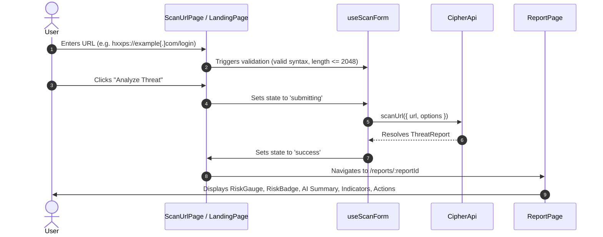
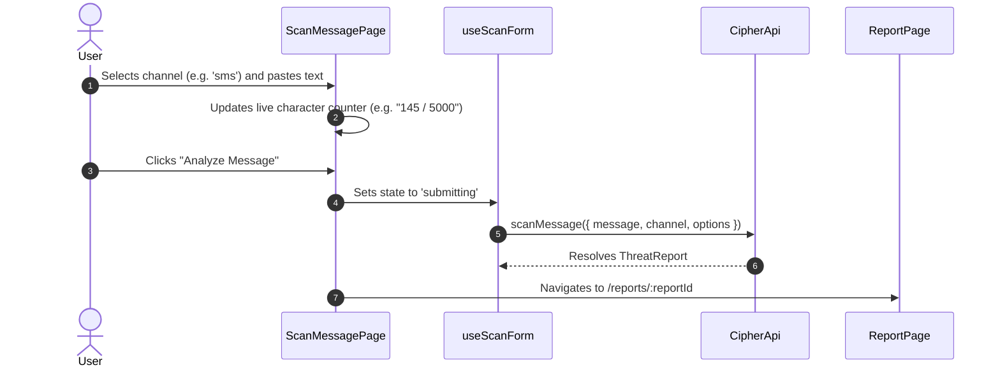
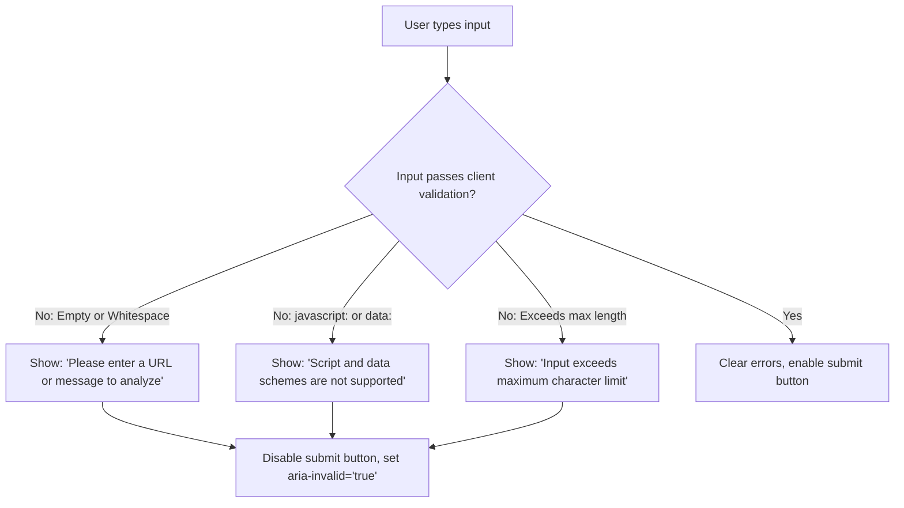
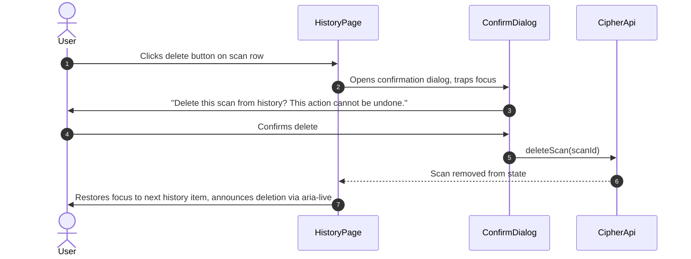

# CIPHER AI — User Flows and State Machine Specification

| Metadata | Details |
| :--- | :--- |
| **Title** | User Flows and State Machine Specification |
| **Phase** | PHASE_02: UI/UX Design System, Page Layouts, Navigation, Reusable Components, Responsive Design, and User Flows |
| **Status** | Approved |
| **Version** | 1.0.0 |
| **Date** | 2026-10-22 |
| **Owner Role** | Senior UI/UX Designer & Frontend Architect |

---

## 1. Overview

This document specifies the primary interaction flows and state transitions in CIPHER AI. The frontend operates with an explicit UI state machine across all scanning and data retrieval workflows:
- `idle`: Form awaiting user input; submit button disabled until valid.
- `validating`: Client-side validation active on change/blur; inline errors mapped via `aria-describedby` and `aria-invalid`.
- `submitting`: Form input disabled; submit button shows accessible loading spinner and `aria-live="polite"` status message (minimum 300ms duration to prevent visual flicker).
- `success`: Threat report received; automatically navigates to `/reports/:reportId` or updates active view.
- `error`: Failed request mapped to standardized `ErrorState` component rendering user-friendly explanation, recovery actions, and trace ID.

---

## 2. Core User Flows

### Flow 1: Scan a URL (Happy Path)

| Step | User Action | System Response | Accessible Feedback |
| :--- | :--- | :--- | :--- |
| 1 | Focuses URL input | Displays placeholder and helper text with reserved domain example. | `aria-describedby="url-helper-text"` |
| 2 | Types or pastes URL | Validates format; enables submit button if valid. | `aria-invalid="false"` |
| 3 | Clicks "Analyze Threat" | Disables input; displays animated loading skeleton and status. | `aria-live="polite"` announcing "Analyzing submitted URL..." |
| 4 | Analysis completes | Navigates to `/reports/:reportId` with focus moved to report heading. | Screen reader announces "Threat Report loaded for [target]" |

---

### Flow 2: Scan a Message (Happy Path)

---

### Flow 3: Invalid Input (Client Validation UX)

---

### Flow 4: Rate Limited (HTTP 429)
When rate limit is reached:
1. User submits request.
2. API / Mock rejects with `ApiError` code `RATE_LIMITED` and optional retry-after metadata.
3. Form remains populated so input is not lost.
4. `ErrorState` component renders with clock icon: *"Rate limit reached. Please wait a moment before running another scan."*
5. Retry button is disabled with countdown timer or re-enables on click.

---

### Flow 5: Backend / Service Unavailable (HTTP 503)
1. User submits request.
2. Client rejects with `DEPENDENCY_UNAVAILABLE` or network failure.
3. `ErrorState` appears with network alert icon: *"CIPHER AI scanning engine is temporarily unreachable. Your input has been saved."*
4. Provides a "Retry Analysis" button with trace ID displayed for support.

---

### Flow 6: AI Fallback Used (Deterministic Summary)
When upstream AI inference fails or is disabled:
1. Scan completes with `processing.ai_status = "fallback_used"`.
2. Report renders normally with deterministic risk score and indicators.
3. `AIExplanationPanel` renders with a neutral informational badge: **"Deterministic Threat Summary"** instead of "AI Threat Summary".
4. Subtitle clarifies: *"Generated based on structured deterministic rules without generative AI synthesis."*
5. Key findings, indicators, and recommended actions remain 100% functional.

---

### Flow 7: Inconclusive Result
When input is unsupported, truncated, or unparsable:
1. Report returns `assessment.risk_level = "inconclusive"` and score `0`.
2. `RiskBadge` shows gray slate palette, `HelpCircle` icon, and text: *"Inconclusive, not enough information"*.
3. Report displays the mandatory notice: *"CIPHER AI could not perform a conclusive evaluation because the input was unparsable, insufficient in length, or unsupported. This result does not imply that the content is benign."*
4. Actions advise safe manual verification.

---

### Flow 8: Delete a History Item

---

### Flow 9: First-Time Visit
1. User navigates to `/`.
2. History panel shows friendly `EmptyState` illustration: *"No recent scans found. Analyze a suspicious link or message above to get started."*
3. Theme defaults to system preference without flickering.
4. Trust cards highlight evidence-first principles and explain that no tool can guarantee 100% safety.

---

## 3. Development-Only State Switcher (`/dev/states`)
In non-production environments (`import.meta.env.DEV === true`), a dedicated route at `/dev/states` allows engineers and designers to preview every component and page state:
- All 5 risk levels (`low`, `medium`, `high`, `critical`, `inconclusive`).
- AI fallback state vs AI generated state.
- Empty states (history empty, indicators empty, evidence unavailable).
- Loading skeleton states.
- Error states (`RATE_LIMITED`, `VALIDATION_ERROR`, `DEPENDENCY_UNAVAILABLE`, `NOT_FOUND`).
- Long URL / Unicode homoglyph adversarial stress test.

This route is excluded from production bundles.
