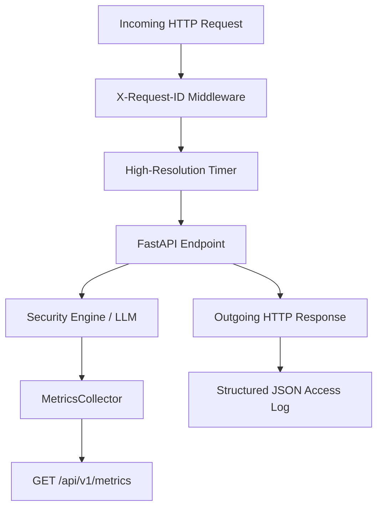

# CIPHER AI: Production Monitoring & Observability Architecture

This specification outlines the telemetry, metrics, structured logging, health probing, and retention policies implemented in CIPHER AI for continuous reliability and performance monitoring.

---

## 1. Observability Overview

CIPHER AI adopts a **zero-overhead, privacy-first observability model**:
- **Structured JSON Logging**: Every log entry is formatted as a single-line JSON object with UTC timestamp, severity level, logger name, and correlation `request_id`.
- **Automatic Secret & PII Masking**: Authorization headers, cookies, API keys, passwords, OTPs, and sensitive user payloads are automatically redacted before disk or stdout emission.
- **Bounded-Cardinality Telemetry**: Metrics normalize dynamic identifiers (e.g. `/cases/{id}`) to fixed label spaces, preventing memory bloat and external monitoring cost explosions.
- **Zero Third-Party Dependency Lock-In**: Telemetry runs natively in-memory via Python's thread-safe primitives, with zero risk of crashing the scanning engine if monitoring collectors degrade.



---

## 2. Telemetry & Metrics Catalog

Access the real-time operational telemetry snapshot via `GET /api/v1/metrics`.

### 2.1 HTTP Traffic & Latency Metrics
- `total_requests`: Monotonically increasing counter of processed HTTP requests.
- `requests_by_endpoint_and_status`: Counter categorized by HTTP method, templated route path, and status class (`2xx`, `4xx`, `5xx`).
- `latencies_by_endpoint`: Average execution latency in milliseconds (`avg_ms`) and invocation counts grouped by endpoint template.

### 2.2 Security Scan Metrics
- `total_scans`: Total URL, message, email, and batch analyses executed.
- `scans_by_type`: Breakdown across `url`, `message`, `email`, and `batch`.
- `scans_by_risk`: Threat level distribution across `LOW`, `MEDIUM`, `HIGH`, and `CRITICAL`.
- `feedback`: Quality reports received from analysts and users (`false_positive`, `false_negative`, `accurate`).

### 2.3 AI / Google Gemini Telemetry
- `total_requests`: Total invocations of the Gemini/LLM analysis pipeline.
- `success_count`: Completions successfully validated against `AIExplanation` schema.
- `success_rate`: Proportion of completed calls without error (target >= 99.0%).
- `avg_latency_ms`: Mean round-trip latency in milliseconds for Gemini generation.
- `breakdown`: Counters by outcome (`success`, `timeout`, `rate_limit`, `error`, `fallback`).

### 2.4 External Reputation Feeds
- `cache_hits`: Number of URL lookups served instantly from memory cache.
- `cache_misses`: Number of queries dispatched to external providers.
- `cache_hit_ratio`: Cache efficiency ratio (target >= 70% in steady state).
- `lookups_by_provider`: Query counts per provider (Google Safe Browsing, VirusTotal, URLhaus).

### 2.5 Error Counters
- `total_errors`: Total application error envelopes returned.
- `errors_by_code`: Bounded counts of standard API error codes (`RATE_LIMITED`, `INPUT_TOO_LARGE`, `UNAUTHORIZED`, `DEPENDENCY_UNAVAILABLE`, `INTERNAL_ERROR`).

---

## 3. Health & Probing Endpoints

CIPHER AI provides distinct liveness and readiness endpoints designed for container orchestrators (Kubernetes, Docker Swarm) and cloud PaaS health probes (Render, Railway, Fly.io, AWS ALB):

| Endpoint | Purpose | Upstream Check | HTTP Status |
| :--- | :--- | :--- | :--- |
| `GET /health` | Universal cloud health probe | Checks process + backing DB (cached) | `200 OK` |
| `GET /health/live` | Liveness probe | Instant check that ASGI loop is responsive | `200 OK` |
| `GET /health/ready` | Readiness probe | Validates DB and critical dependencies | `200 OK` (or `200 OK` degraded) |
| `GET /api/v1/health` | Detailed diagnostic report | Detailed dependencies report for admins | `200 OK` |

### Sample Liveness Response
```json
{
  "status": "alive",
  "timestamp": "2026-10-23T02:20:00.000000Z"
}
```

### Sample Readiness Response
```json
{
  "status": "ready",
  "timestamp": "2026-10-23T02:20:00.000000Z",
  "dependencies": {
    "database": "ok",
    "llm": "enabled"
  }
}
```

---

## 4. Structured Logging Specifications

All log lines follow this JSON schema:

```json
{
  "timestamp": "2026-10-23T02:20:00.123456Z",
  "level": "INFO",
  "logger": "cipher.access",
  "message": "Access log",
  "request_id": "c1f8a920-5678-4321-abcd-0123456789ab",
  "method": "POST",
  "path": "/api/v1/scans/url",
  "status_code": 200,
  "duration_ms": 34.21
}
```

### Redaction Rules
- Keys named `authorization`, `cookie`, `set-cookie`, `api_key`, `token`, `password`, `secret`, `supabase_service_role_key` are replaced with `[REDACTED]`.
- Inline regex filters intercept and mask strings matching `Bearer <token>` or `apikey:<token>`.
- Request bodies, passwords, OTPs, and raw submitted message strings are **never** logged to access logs.

---

## 5. Security & Access Control

1. **Production Token Authentication**:
   - Set `METRICS_AUTH_TOKEN=<random-32-char-secret>` in production environment variables.
   - When set, requests to `GET /api/v1/metrics` require the `X-Metrics-Token` header or `Authorization: Bearer <token>`.
2. **Data Minimization & Retention**:
   - In-memory metrics retain only aggregate numerical counters and averages.
   - Database scan retention is governed by `SCAN_RETENTION_DAYS` (default: 90 days), purgeable via `scripts/purge_expired_scans.py`.
