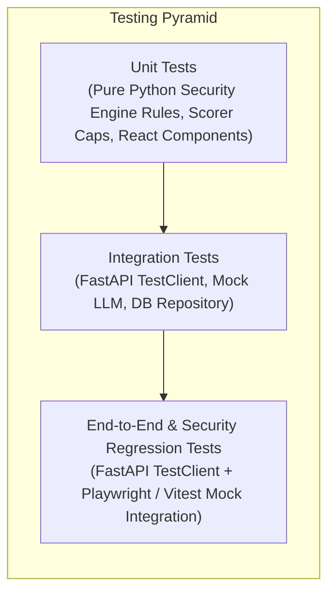
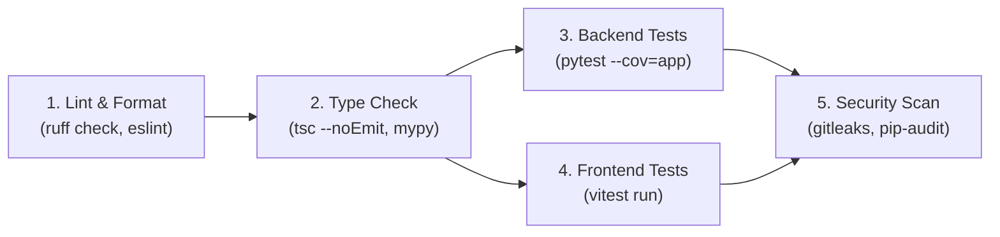

# CIPHER AI — Testing and QA Strategy

| Metadata | Details |
| :--- | :--- |
| **Title** | Testing and QA Strategy |
| **Phase** | PHASE_01: Requirements, Scope, Architecture, and Technical Specification |
| **Status** | Approved |
| **Version** | 1.0.0 |
| **Date** | 2026-10-22 |
| **Owner Role** | Senior Security Engineer & QA Lead |

---

## 1. Overview & Quality Objectives

The CIPHER AI testing strategy enforces strict quality gates across both frontend and backend tiers. Because CIPHER AI evaluates adversarial and deceptive inputs, test suites place heavy emphasis on **deterministic reproducibility, edge case handling, adversarial fuzzing, and prompt-injection resilience**.

### Quality Targets
- **Security Engine Unit Test Coverage:** Minimum **85%** on `api/app/engine/*`.
- **Overall Codebase Test Coverage:** Minimum **70%** across frontend and backend.
- **Flakiness Policy:** Zero flaky or stochastic tests allowed in CI; external LLM calls are strictly mocked in test suites.

---

## 2. Test Pyramid & Tooling

| Layer | Framework / Tools | Scope & Responsibilities | Target Run Time |
| :--- | :--- | :--- | :--- |
| **Backend Unit Tests** | `pytest`, `pytest-cov`, `pytest-asyncio` | Evaluates URL validators, indicator rules, score calculation, category caps, fallback logic, and Pydantic schemas in memory. | < 2 seconds |
| **Backend Integration Tests** | `pytest`, FastAPI `TestClient`, `httpx` | Tests API route endpoints, error envelopes, rate limiting, session isolation, and repository persistence. | < 5 seconds |
| **Frontend Component Tests** | `vitest`, `@testing-library/react`, `jsdom` | Tests `RiskGauge`, `ScanInputCard`, `IndicatorList`, defanged rendering, accessibility roles, and error states. | < 4 seconds |
| **Adversarial & Security Tests** | `pytest`, custom fixture matrix | ReDoS benchmarking, prompt injection defenses, XSS payload neutralization, SSRF egress checks. | < 3 seconds |

---

## 3. Test Fixtures Strategy

Test fixtures reside in `api/tests/fixtures/` and are organized into four explicit tiers:

1. **Benign Baseline Fixtures:** Standard registered domains, everyday conversational messages, legitimate transaction notices. Verifies low scores and prevents false-alarm floods.
2. **Suspicious / Known Scam Fixtures:** Common phishing lures, IP hosts, URL shorteners, fake delivery SMS, CEO wire fraud text. Verifies high/critical scores and category caps.
3. **Adversarial / Injection Fixtures:** 15 test cases (`ADV-01` to `ADV-15`) designed to test prompt injection, instruction override, system prompt extraction, and JSON schema poisoning.
4. **Pathological & Boundary Fixtures:** 2,048-char URLs, 5,000-char messages, 10,000-char ReDoS strings, zero-width characters, non-printable bytes, empty strings.

---

## 4. Continuous Integration (CI) Pipeline

A unified GitHub Actions workflow (`.github/workflows/ci.yml`) executes on every Pull Request to `main`:

1. **Lint & Code Style:** `ruff check api/` and `npm run lint` (ESLint).
2. **Type Safety:** `mypy api/app/` and `npm run typecheck` (`tsc --noEmit`).
3. **Backend Test Suite:** `pytest --cov=app --cov-fail-under=70 api/tests/`.
4. **Frontend Test Suite:** `npm test -- --run` (Vitest).
5. **Secret & Vulnerability Audit:** `gitleaks detect` ensuring zero keys committed.

---

## 5. Story-to-Test Traceability Matrix (MVP)

This matrix maps every MVP User Story (`US-001` through `US-015`) to its specific planned automated test implementations.

| Story ID | Story Title | Planned Automated Test Suite / Function | Test Type | Acceptance Verification |
| :--- | :--- | :--- | :--- | :--- |
| **US-001** | Submit Suspicious URL | `api/tests/integration/test_scans_api.py::test_scan_url_success` `web/src/components/scan/ScanInputCard.test.tsx` | Integration / Unit | Submits valid URL; asserts 200 OK, defanged display, valid ThreatReport. |
| **US-002** | Submit Scam Message | `api/tests/integration/test_scans_api.py::test_scan_message_success` `api/tests/unit/test_message_analyzer.py` | Integration / Unit | Submits message; asserts urgency & financial indicators; verifies zero raw message stored. |
| **US-003** | Score Breakdown Table | `api/tests/unit/test_scoring.py::test_score_contributions_and_caps` `web/src/components/report/ScoreBreakdownTable.test.tsx` | Unit / Component | Asserts every contribution has reason, points, evidence kind; tests cap enforcement. |
| **US-004** | Plain-Language AI Explanation | `api/tests/unit/test_ai_client.py::test_ai_explanation_schema_validation` `web/src/components/report/AIExplanationPanel.test.tsx` | Unit / Component | Verifies summary < 600 chars; verifies every cited indicator ID exists in report. |
| **US-005** | Recommended Actions | `api/tests/unit/test_report_builder.py::test_recommended_actions_priority` `web/src/components/report/RecommendedActionsList.test.tsx` | Unit / Component | Asserts actions sorted by priority starting at 1; verifies imperative text phrasing. |
| **US-006** | View Session History | `api/tests/integration/test_scans_api.py::test_list_scans_session_isolation` `web/src/pages/HistoryPage.test.tsx` | Integration / Component | Creates 3 scans; asserts `GET /api/v1/scans` returns exactly those 3 for matching session. |
| **US-007** | Delete Scan from History | `api/tests/integration/test_scans_api.py::test_delete_scan_success` `api/tests/integration/test_scans_api.py::test_delete_scan_idor_forbidden` | Integration | Issues `DELETE /api/v1/scans/{id}`; asserts 204 No Content; confirms item omitted from list. |
| **US-008** | Input Validation Handling | `api/tests/integration/test_scans_api.py::test_invalid_url_returns_422` `api/tests/integration/test_scans_api.py::test_oversized_input_returns_413` | Integration | Submits malformed strings and >2,048 chars; verifies standard ErrorEnvelope returned. |
| **US-009** | AI Outage Fallback | `api/tests/unit/test_ai_fallback.py::test_deterministic_fallback_on_llm_failure` `api/tests/integration/test_scans_api.py::test_scan_succeeds_when_llm_down` | Unit / Integration | Mocks LLM timeout (15s); verifies report completes with `ai_status: fallback_used`. |
| **US-010** | Inconclusive Result Handling | `api/tests/unit/test_scoring.py::test_inconclusive_conditions` `web/src/components/report/RiskGauge.test.tsx` | Unit / Component | Analyzes 3-character string; verifies `risk_level: inconclusive`, score 0, limitation text. |
| **US-011** | Mobile Responsive Layout | `web/src/test/responsive_layout.test.tsx` | Component / Layout | Emulates 360px viewport; verifies zero horizontal overflow and min 44px touch targets. |
| **US-012** | Dashboard Summary | `api/tests/integration/test_dashboard_api.py::test_dashboard_summary_metrics` `web/src/pages/DashboardPage.test.tsx` | Integration / Component | Populates test scans; queries `/dashboard/summary`; checks risk breakdown and top 5 indicators. |
| **US-013** | IDN Homoglyphs & Punycode | `api/tests/unit/test_url_analyzer.py::test_homoglyph_and_punycode_detection` | Unit | Submits Cyrillic 'a' homoglyph; verifies `URL_HOMOGLYPH_PUNYCODE` triggers with 40 pts. |
| **US-014** | IP Address Host Detection | `api/tests/unit/test_url_analyzer.py::test_ip_host_detection` `api/tests/unit/test_url_analyzer.py::test_ssrf_zero_network_calls` | Unit / Security | Submits `192.0.2.14` and `127.0.0.1`; confirms `URL_IP_HOST` triggers without network socket creation. |
| **US-015** | Low-Risk Disclaimer Notice | `api/tests/unit/test_report_builder.py::test_low_risk_mandatory_limitation` `web/src/components/report/DisclaimerBanner.test.tsx` | Unit / Component | Evaluates clean example URL; confirms score 0, verdict label, and verbatim limitation copy. |

---

## 6. Document Cross-References

- [User Stories](file:///docs/requirements/user-stories.md)
- [Non-Functional Requirements](file:///docs/requirements/non-functional-requirements.md)
- [Threat and Abuse Model](file:///docs/security/threat-model.md)
- [Risk Scoring Specification](file:///docs/architecture/risk-scoring-spec.md)
